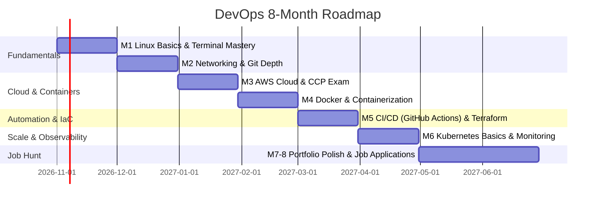

# DevOps Master Roadmap (Zero to Job-Ready)

> **Learner:** Karan Singh  
> **Timeline:** 6–8 Months (3 hrs/day)  
> **Approach:** Alvar Method (*Probe ➔ Plan ➔ Teach ➔ Lock-in*)  
> **Initial Upfront Cost:** ₹0 (Free Tier & Curated Free Resources)  
> **Core Objective:** Build 3 production-grade portfolio projects, pass 2 certifications, and secure a DevOps Engineer role.

---

## 🧭 The 8-Month Trajectory



---

## 🗺️ Step-by-Step Phases

### Phase 1: Linux Fundamentals (Month 1)
- **Goal:** Unshakable comfort in the terminal. No GUI dependencies.
- **Key Commands:**
  - Filesystem: `ls`, `cd`, `mkdir`, `rm`, `cp`, `mv`, `cat`, `grep`, `find`
  - Permissions: `chmod`, `chown`, file modes (e.g. `755`, `644`)
  - Processes: `ps`, `top`, `kill`
  - System: SSH keys, package managers (`apt`/`yum`), `cron` jobs, terminal editors (`nano`/`vim`)
  - Automation: Basic Bash scripting
- **Mini-Project (Week 3):** Automated Bash script for folder setup, data download, and path migration.
- **Primary Resource:** NetworkChuck *Linux for Hackers (and Everyone)* + `linuxjourney.com`.

### Phase 2: Networking Basics & Git (Month 2)
- **Goal:** Understand network plumbing (fixes 90% of cloud bugs) and source control mastery.
- **Networking:** IPv4/IPv6, DNS, TCP vs. UDP, common ports (`80`, `443`, `22`, `3306`), HTTP vs. HTTPS, subnets, CIDR notation, firewalls, and OSI model.
- **Git:** Workflows, feature branches, rebasing, resolving merge conflicts, PR etiquette, and `.gitignore`.

### Phase 3: AWS Cloud & Certification #1 (Month 3)
- **Goal:** Cloud-native architecture fundamentals.
- **AWS Services in Priority Order:**
  1. `IAM` — Policies, roles, least-privilege security
  2. `EC2` — Virtual compute instances
  3. `S3` — Object storage and static asset hosting
  4. `VPC & Security Groups` — Private cloud network topology and firewalls
  5. `RDS` — Managed relational databases
  6. `Route 53 & CloudFront` — DNS and global CDN caching
  7. `CloudWatch` — Monitoring, metrics, and alerting
- **✦ Must-Build Project #1:** Deploy a React frontend on AWS S3 + CloudFront with custom domain & HTTPS.
- **Certification Target:** AWS Certified Cloud Practitioner (CCP) (~$100 / ₹8,300).

### Phase 4: Docker & Containers (Month 4)
- **Goal:** Packaging applications cleanly with zero environment discrepancies.
- **Topics:** Containers vs. VMs, Docker CLI (`run`, `ps`, `stop`, `rm`, `build`), Dockerfile optimization, multi-stage builds, volumes (data persistence), Docker networking, and Docker Compose.
- **Mini-Project:** Multi-stage Dockerfile packaging your React app, verified and running locally.

### Phase 5: CI/CD Pipelines (Months 4–5)
- **Goal:** Full deployment automation — push code to GitHub and let automation handle tests, builds, and deploys.
- **Topics:** GitHub Actions (Workflows, Jobs, Steps, Secrets), YAML syntax, automated unit/integration tests, automated Docker build, pushing to AWS ECR, and deployment to EC2.
- **✦ Must-Build Project #2 (Core Anchor):** Full CI/CD pipeline: Git push ➔ GitHub Actions ➔ Test ➔ Build Docker Image ➔ Push to ECR ➔ Auto-deploy to EC2.

### Phase 6: Terraform / Infrastructure as Code (Month 5)
- **Goal:** Code your entire infrastructure. No manual console clicking.
- **Topics:** Terraform syntax, AWS provider, resource declaration (`VPC`, `EC2`, `S3`, `SG`), variables/outputs, state management (`terraform.tfstate`), remote state in S3 with DynamoDB locking.
- **✦ Must-Build Project #3:** Full AWS infrastructure written in Terraform, hosting Project #2.
- **Certification Target:** AWS Solutions Architect Associate (SAA) (~$150 / ₹12,500) — *The primary resume builder*.

### Phase 7: Kubernetes Fundamentals (Months 5–6)
- **Goal:** High-level orchestration understanding. Do not over-learn for entry-level.
- **Topics:** Pods, Deployments, Services (`ClusterIP`, `NodePort`, `LoadBalancer`), basic `kubectl`, Namespaces, ConfigMaps, Secrets, Minikube.

### Phase 8: Monitoring & Python Scripting (Month 6)
- **Goal:** Observability and task automation.
- **Topics:** Prometheus metrics scraping, Grafana dashboards & alerts, AWS CloudWatch alarms, Python scripting with `boto3` (AWS SDK).

### Phase 9: Portfolio, Applications & Interviews (Months 7–8)
- **Goal:** Converting work into interviews.
- **Checklist:**
  - 3 clean GitHub repositories with professional architecture diagrams and READMEs.
  - 1-page resume with projects at the very top.
  - Active LinkedIn posting 1x per week documenting the journey.
  - Apply to 10–15 jobs/week starting Month 6.

---

## 🏆 The 3 Portfolio Projects

| # | Project Name | Tech Stack | What It Proves |
|---|---|---|---|
| **1** | **Cloud-Hosted Web Application** | React, AWS S3, CloudFront, Route 53, ACM | Proves understanding of static asset delivery, DNS, and SSL/TLS. |
| **2** | **Production CI/CD Pipeline** | GitHub Actions, Docker, AWS ECR, EC2 | Proves automated building, containerization, and hands-off delivery. |
| **3** | **Automated Cloud with IaC** | Terraform, AWS VPC, EC2, S3, Security Groups | Proves repeatable, declarative infrastructure provisioning. |

---

## ⏱️ Daily 3-Hour Cadence

```
┌─────────────────┬─────────────────┬─────────────────┐
│  Hour 1: Learn  │  Hour 2: Build  │ Hour 3: Fix/Log │
│  (Docs / Video) │ (Terminal / AWS)│ (Debug & Commit)│
└─────────────────┴─────────────────┴─────────────────┘
```
* **Weekdays:** 3 focused hours daily.
* **Weekends:** 4–5 hours on projects only. No tutorial switching.

---

## 📜 Certifications Target

1. **AWS Cloud Practitioner (CCP)**: Month 3 (~$100 / ₹8,300) — Foundation verification.
2. **AWS Solutions Architect Associate (SAA)**: Month 5 (~$150 / ₹12,500) — High employer demand.
3. **HashiCorp Terraform Associate (Optional Bonus)**: Months 6–7 (~$70 / ₹5,800) — Distinguishing edge.
