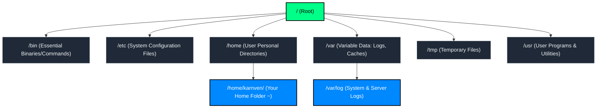
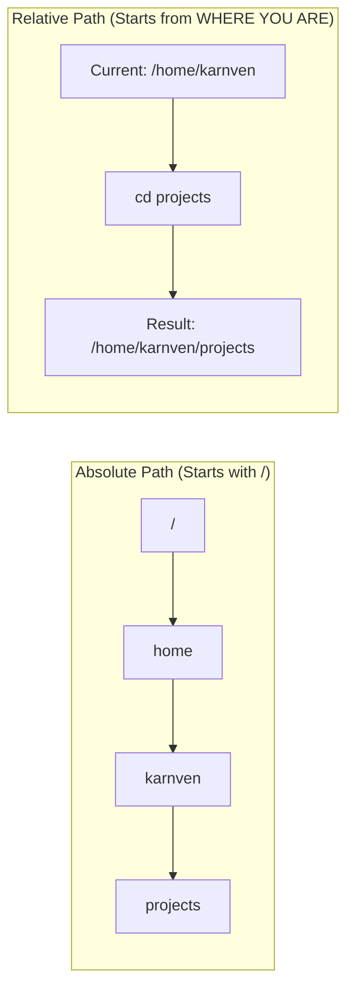

# Linux Ep. 01: Terminal & Filesystem Navigation

> **Topic:** Linux Core Foundations & Directory Navigation  
> **Source:** NetworkChuck — Linux for Hackers // EP 1  
> **Tags:** `#devops` `#linux` `#phase-1` `#terminal` `#navigation`  
> **Status:** Completed  

---

## 1. Unconditional Truths (The Axioms)

1. **Everything Starts at Root (`/`)**: Unlike Windows (which isolates storage by drive letters `C:\`, `D:\`), Linux arranges the entire universe into a single hierarchical inverted tree starting at `/`.
2. **Case Sensitivity is Absolute**: `folder`, `Folder`, and `FOLDER` are three completely different directories. Typos in case will cause `No such file or directory`.
3. **Dotfiles Are Hidden**: Any file or folder starting with a period (`.bashrc`, `.ssh/`) is hidden by convention. Standard directory listings ignore them unless explicitly told otherwise.
4. **Dots Represent Relative Position**:
   - `.` (single dot) represents the *current* directory.
   - `..` (double dot) represents the *parent* directory (one step up).
5. **Headless Dominance**: Servers do not have screens or mice. DevOps engineers control servers across the globe purely through text streams over SSH.

---

## 2. Motivated Discovery ("Why does this exist?")

### The Problem with GUIs in Operations
A Graphical User Interface (GUI) is designed for visual human interaction, which presents three fatal flaws in production engineering:
- **Resource Overhead**: Rendering windows, desktop environments, and mouse pointers consumes significant RAM and CPU cycles that should be allocated to databases and application workloads.
- **Inability to Automate**: You cannot easily tell a CI/CD pipeline or an automated script to "click the third button on the screen".
- **Scalability Limit**: You cannot click buttons across 500 servers simultaneously. You *can* run a terminal command across 500 servers in parallel.

The **Command Line Interface (CLI)** exists because plain text is universal, deterministic, lightweight, and scriptable.

---

## 3. Dependency Map & Architectural Hierarchy

### The Linux Filesystem Tree



### Path Resolution Architecture: Absolute vs. Relative



---

## 4. Hands-on Command Cheatsheet & Terminal Drills

### The Shell Prompt Anatomy
```text
karnven@ubuntu-server:~/projects$
└──┬──┘ └─────┬─────┘ └───┬───┘ └┬┘
   │          │           │      └── $ = Standard User (# = Root Superuser)
   │          │           └───────── Current Directory (~ means your /home directory)
   │          └───────────────────── Hostname (Machine Name)
   └──────────────────────────────── Logged-in Username
```

### Essential Navigation Commands

| Command | Full Name | Explanation & Use Case | Key Flags / Variations |
| :--- | :--- | :--- | :--- |
| `pwd` | **P**rint **W**orking **D**irectory | Outputs the absolute path of your current location. | None needed. Run anytime you feel disoriented. |
| `ls` | **L**i**s**t | Lists files and folders in a target directory (defaults to current). | `ls -l` (detailed view: permissions, owner, size)<br>`ls -a` (shows hidden dotfiles)<br>`ls -la` or `ls -lh` (combined: all files + human readable sizes) |
| `cd` | **C**hange **D**irectory | Moves your shell session to a different directory. | `cd ..` (go up one level)<br>`cd ~` or `cd` (return to home)<br>`cd -` (jump back to previous directory)<br>`cd /` (jump to filesystem root) |

---

### 🧪 5-Minute Terminal Drill (Run in your WSL2 / Ubuntu terminal)

1. **Verify your identity and location:**
   ```bash
   whoami
   pwd
   ```
2. **Explore the root of the operating system:**
   ```bash
   cd /
   ls -la
   ```
   *(Notice `/etc`, `/var`, `/bin`, `/home` — these are the core organs of Linux)*
3. **Observe hidden configuration files:**
   ```bash
   cd ~
   ls
   ls -a
   ```
   *(Notice the difference: `ls -a` reveals hidden files like `.bashrc` and `.profile`)*
4. **Test the "Rubber Band" jump (`cd -`):**
   ```bash
   cd /var/log
   pwd
   cd -
   pwd
   ```
   *(Notice how `cd -` bounces you back and forth between your last two working directories)*
5. **Practice parent stepping:**
   ```bash
   cd /etc/systemd
   cd ..
   pwd
   ```

---

## 5. Key Takeaways & Common Pitfalls

> [!IMPORTANT]
> **The Leading Slash (`/`) Trap**:
> - `cd etc` (Relative path): Searches for a folder called `etc` *inside where you currently stand*. If you are in `/home/karnven`, it looks for `/home/karnven/etc` and will likely error out.
> - `cd /etc` (Absolute path): Jumps directly to the system configuration directory at the root of the OS, regardless of where your cursor is.

> [!TIP]
> **Tab Completion is Your Best Friend**:
> Never type full directory names manually. Type `cd /e` and press `Tab`. Linux will autocomplete `/etc/`. If multiple options exist, press `Tab` twice to display all possibilities.

> [!WARNING]
> **Spaces in Directory Names**:
> Linux treats a space as an argument separator. A folder named `DevOps Notes` must be accessed using quotes (`cd "DevOps Notes"`) or backslash escaping (`cd DevOps\ Notes`). Best practice in DevOps: **never use spaces in file/directory names — use dashes (`-`) or underscores (`_`)**.
