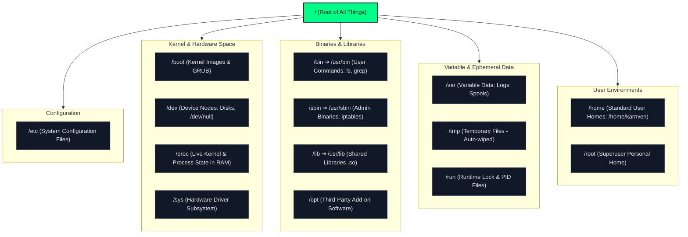
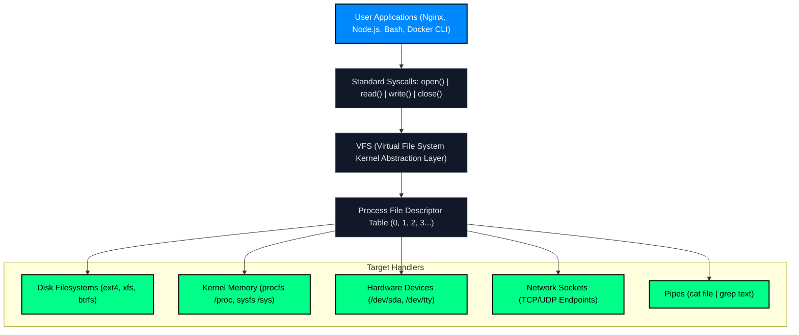

# Linux Ep. 02: Filesystem Hierarchy (FHS) & "Everything is a File"

> **Topic:** The Linux Root Tree, System Directories, Virtual File System (VFS), and File Descriptors  
> **Source:** NetworkChuck — Linux for Hackers // EP 2  
> **Tags:** `#devops` `#linux` `#phase-1` `#filesystem` `#fhs` `#vfs` `#file-descriptors`  
> **Status:** Completed  

---

## 1. Unconditional Truths (The Axioms)

1. **"Everything is a File"**: In Unix/Linux, whether you are interacting with an SSD, a network connection, a terminal window, a hardware mouse, or a text document, the interface is identical: **`open()`, `read()`, `write()`, `close()`**.
2. **Commands are Just Plain Files**: A terminal command is not a magical built-in spell. Commands like `ls`, `cat`, and `grep` are literally compiled executable binary files sitting inside `/usr/bin/`. If you copy `/usr/bin/ls` to `/usr/bin/karn`, typing `karn` will execute `ls`.
3. **`/` (Root Directory) $\neq$ `/root` (Root User Home)**:
   - `/` is the single root of the entire operating system tree. Every directory lives inside `/`.
   - `/root` is simply the personal home directory for the root superuser (like `C:\Users\Administrator` in Windows).
4. **`/proc` and `/sys` Do Not Exist on Disk**: They are virtual filesystems generated dynamically by the Linux kernel in RAM. They consume 0 bytes of disk space. Deleting them is impossible; rebooting resets them.
5. **File Descriptors (FDs) are Integer Pointers**: Every time a program opens any resource (file, database connection, socket), the kernel assigns it an integer pointer. Every Linux process starts with three default open file descriptors:
   - `0`: **`stdin`** (Standard Input - keyboard/stream)
   - `1`: **`stdout`** (Standard Output - screen/stream)
   - `2`: **`stderr`** (Standard Error - error log/stream)
6. **The Modern `/usr` Merge**: On modern Ubuntu and systemd-based distributions, `/bin`, `/sbin`, and `/lib` are symbolic links (shortcuts) pointing to `/usr/bin`, `/usr/sbin`, and `/usr/lib`.

---

## 2. Motivated Discovery ("Why Does This Exist?")

### The Historical Chaos: Pre-Unix Computing (Early 1970s)
Before Unix, every computer hardware peripheral had its own proprietary assembly API:
- Magnetic tape drives required Tape API commands and specific buffer blocks.
- Printers required printer interrupts.
- Hard drives required sector-mapping logic.

If a developer wrote code to read employee payroll records from tape, and the company later upgraded to a hard drive, **the entire program had to be rewritten**.

### The Breakthrough: The Unified Byte Stream
Ken Thompson and Dennis Ritchie conceived a revolutionary design:
> *"What if every device, process, and communication channel pretended to be a sequential stream of bytes?"*

By abstracting everything into a byte stream, any program that can write text to a file can also:
- Transmit packets across a network
- Display text on a terminal screen
- Send commands to a disk drive
- Pipe output directly into another program (`stdout` ➔ `stdin`)

This gave rise to **composability** (the Unix Philosophy: build small modular tools that do one thing well, and chain them together).

---

## 3. Architectural Taxonomy & The VFS

### The Linux Filesystem Tree


### The Virtual File System (VFS) Layer
User applications never communicate directly with hardware or disk drivers. They talk to the **VFS**, which exposes identical system calls across all resource types:



---

## 4. Deep Dive: The 7 POSIX File Types

When running `ls -l`, the **first character** of the permission string reveals what kind of "file" it is:

| Char | File Type | Description | Production Example |
| :---: | :--- | :--- | :--- |
| **`-`** | **Regular File** | Executable binary, image, configuration text, or script. | `/etc/passwd`, `/bin/bash` |
| **`d`** | **Directory** | A special file holding a table of filenames and inode numbers. | `/var/log`, `/home/karnven` |
| **`l`** | **Symbolic Link** | A text pointer holding the path to another target file. | `/bin` ➔ `/usr/bin` |
| **`c`** | **Character Device** | Unbuffered serial stream of bytes (one character at a time). | `/dev/tty` (terminal), `/dev/null`, `/dev/urandom` |
| **`b`** | **Block Device** | Buffered hardware storage reading/writing in fixed blocks (4KB). | `/dev/sda` (SSD/Hard drive), `/dev/nvme0n1` |
| **`s`** | **Socket (UNIX Domain)** | High-speed local inter-process communication endpoint. | `/var/run/docker.sock` |
| **`p`** | **Named Pipe (FIFO)** | A First-In-First-Out pipe where one process writes and another reads. | Custom IPC pipes created via `mkfifo` |

---

## 5. Core Directory Breakdown & DevOps Reality

| Directory | What Lives Inside | DevOps Operational Importance |
| :--- | :--- | :--- |
| **`/etc`** | System configuration files (plain text: Nginx, SSH, network). | **Critical.** 70% of infrastructure configuration is editing or templating files in `/etc` (e.g. `/etc/ssh/sshd_config`, `/etc/hosts`). |
| **`/var`** | Variable data: logs (`/var/log`), web files (`/var/www`). | **Critical.** When servers fail in production, the first place you inspect is `/var/log/syslog` or `/var/log/nginx/error.log`. |
| **`/dev`** | Special device nodes representing hardware and pseudo-devices. | High. Redirect unwanted script output to `/dev/null`: `command > /dev/null 2>&1`. |
| **`/proc`** | Live kernel and process state mapped as virtual files in RAM. | High. Monitoring agents (Prometheus, Datadog) scrape `/proc/meminfo` and `/proc/cpuinfo` to measure usage. |
| **`/home`** | Personal directories for non-root users. | Medium. Holds user SSH keys (`~/.ssh/id_ed25519`) and shell configs (`~/.bashrc`). |
| **`/tmp`** | Scratch space accessible by all users; auto-wiped on reboot. | Medium. Used for temporary build artifacts. Never store persistent data here. |
| **`/opt`** | Self-contained third-party software packages. | Medium. Datadog agents, AWS CLI, and standalone software often install here. |

---

## 6. Deep Dive: What is a "Command" Really? (The Binary & `$PATH` Mystery)

### What Happens When You Type `ls`?
The terminal doesn't inherently "know" what `ls` means. When you press Enter:
1. The shell searches through the directories listed in your **`$PATH`** environment variable (e.g., `/usr/local/bin`, `/usr/bin`).
2. It looks for a file named `ls` with execute permissions (`+x`).
3. It finds `/usr/bin/ls` and asks the Linux kernel to execute the compiled machine code inside it.

```text
You type: "ls"
   │
   ▼
Check $PATH folders ──> Found: /usr/bin/ls ──> Kernel executes binary ──> Output listed
```

### Why Renaming or Copying Works
If you copy `/usr/bin/ls` to `/usr/local/bin/karn`:
```bash
sudo cp /usr/bin/ls /usr/local/bin/karn
```
When you type `karn`, the shell searches `$PATH`, finds `/usr/local/bin/karn`, and executes the exact same binary code. To Linux, **the name of the file is just a label pointing to an inode**.

### The "Chameleon" Binary Phenomenon (`argv[0]`)
Can a program know what name you called it by? **Yes!**
In C/Go/Rust, the first argument passed to a program (`argv[0]`) is the name used to execute it. Some tools change their behavior based on their filename:
- **`busybox`** (used in Alpine Linux & Docker): It is a single tiny binary. If symlinked as `ls`, it lists files. If symlinked as `cat`, it prints files!
- **`gunzip`**: On many systems, `gunzip` is literally a link to `gzip`. When called as `gunzip`, it unzips; when called as `gzip`, it zips.

### Copying vs. Symlinking vs. Aliasing

| Approach | Command | How it works | Best Use Case |
|---|---|---|---|
| **Copy Binary** | `cp /bin/ls ~/bin/karn` | Duplicates physical bytes on disk. | Rarely recommended (wastes space, doesn't get security updates). |
| **Symbolic Link** | `ln -s /bin/ls ~/bin/karn` | Creates a lightweight pointer to the original binary. | When you want system-wide shortcuts that stay updated. |
| **Shell Alias** | `alias karn='ls -la'` | Tells your shell to replace a word with a command string. | **DevOps standard** for custom workflows and shortcuts. |

---

## 7. Real-World DevOps Production Implications

### 1. The Critical Docker Socket: `/var/run/docker.sock`
When you execute `docker run ...`, the Docker CLI does not manage containers directly. It simply connects to the UNIX socket file `/var/run/docker.sock` and transmits HTTP instructions to the Docker daemon.
> **Security Warning:** If you mount `/var/run/docker.sock` into an untrusted container, that container can instruct the Docker daemon to mount the host's root filesystem, gaining immediate **`root` control over the entire physical host**.

### 2. The Dreaded "Too Many Open Files" Outage (`EMFILE`)
In Linux, every incoming web request = 1 TCP socket file descriptor. Every database query = 1 file descriptor. Every log output = 1 file handle.  
If traffic spikes, your process can hit the default Linux process limit (`1024` open files, checked via `ulimit -n`). Nginx and Node.js will immediately crash with:
```text
Error: EMFILE: too many open files
```
DevOps engineers fix this by modifying `/etc/security/limits.conf` to set `nofile` to `65535` or higher.

### 3. Native Network Calls in Pure Bash (No `curl`!)
Because network sockets are mapped as files, you can query a web server using raw Bash file redirection:
```bash
exec 3<>/dev/tcp/google.com/80
echo -e "GET / HTTP/1.1\r\nHost: google.com\r\nConnection: close\r\n\r\n" >&3
cat <&3 | head -n 12
```

---

## 8. 🧪 Hands-On Terminal Drills (Run in WSL2 / Ubuntu)

```bash
# 1. Discover where the "ls" command physically lives on disk:
which ls

# 2. Inspect your $PATH (where the shell looks for commands):
echo $PATH

# 3. Create your own local command:
mkdir -p ~/bin
cp /bin/ls ~/bin/karn
~/bin/karn -la

# 4. Inspect your current shell's live File Descriptors (0=stdin, 1=stdout, 2=stderr):
ls -l /proc/$$/fd

# 5. Talk directly to your terminal device file:
tty
echo "Writing directly to terminal device file!" > $(tty)

# 6. Test the /dev/null "Black Hole":
echo "Normal message"
echo "Vanishing message" > /dev/null
```

---

## 9. Key Takeaways & Common Pitfalls

> [!CAUTION]
> **The `/var/log` Disk Exhaustion Outage**:
> If logs in `/var/log` are not rotated, they silently consume 100% of the disk partition. When disk space hits 100%, databases crash, Docker cannot launch containers, and SSH logins fail. DevOps engineers use `logrotate` to prevent this.

> [!TIP]
> **Commands are Not Magic**:
> Always remember: typing a command is just asking the kernel to open an executable file found in `$PATH`. If a command says `command not found`, either the binary file doesn't exist, lacks `+x` execute permission, or its folder isn't in `$PATH`.
