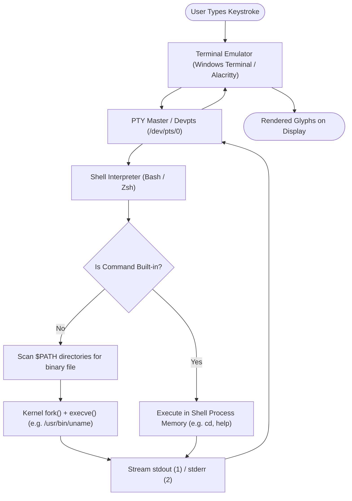
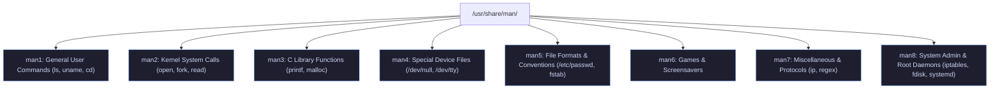

# Linux Ep. 03: Getting Help, Terminal vs. Shell & System Discovery

> **Topic:** Terminal vs. Shell Mechanics, Built-in Help Systems (`man`, `apropos`), and Core System Discovery Commands  
> **Source:** NetworkChuck — Linux for Hackers // EP 3 (`https://www.youtube.com/watch?v=Y17KTiJLcyQ`)  
> **Tags:** `#devops` `#linux` `#phase-1` `#terminal` `#shell` `#man-pages` `#system-discovery`  
> **Status:** Completed  

---

## 1. Unconditional Truths (The Axioms)

1. **A Terminal is NOT a Shell**:
   - The **Terminal (or Terminal Emulator)** is purely an input/output display device wrapper (e.g., Windows Terminal, Alacritty, GNOME Terminal, PuTTY). It captures keystrokes and renders characters on your screen.
   - The **Shell** is the command language interpreter program running *inside* the terminal session (e.g., `bash`, `zsh`, `fish`, `sh`). It parses your text, executes system calls, manages processes, and returns output back to the terminal.
2. **Commands are Either Built-ins or Disk Binaries**:
   - **Built-in commands** (e.g., `cd`, `echo`, `type`, `help`, `pwd` in some shells) execute directly inside the running shell process memory—no process is forked.
   - **External binaries** (e.g., `ls`, `uname`, `grep`, `ss`) are compiled files stored on disk (typically `/usr/bin/`). Running them causes the kernel to `fork()` and `execve()` a new child process.
3. **The Linux System is 100% Self-Documenting**:
   - Every standard Linux system contains its complete technical documentation stored locally in `/usr/share/man/`. You do not need an internet connection or a browser to master any installed command.
4. **The `man` System has 8 Strict Architectural Sections**:
   - Manual pages are indexed by audience and layer (Section 1 = User Commands, Section 2 = Kernel System Calls, Section 5 = File Formats, Section 8 = Root/System Administration).
   - If a name is ambiguous (e.g., `passwd`), `man passwd` defaults to the Section 1 command, while `man 5 passwd` opens the documentation for the configuration file `/etc/passwd`.
5. **System Discovery Precedes Any Operational Change**:
   - In production and incident response, never issue modifying commands before establishing ground truth: **Who am I?** (`id`), **What OS/Kernel is running?** (`uname -a`), **What hardware/disks are attached?** (`lsblk`), and **What is listening on the network?** (`ss -tulpn`).

---

## 2. Motivated Discovery ("Why Does This Exist?")

### The Historical Hardware Origin: Teletypes (TTY)
In the 1960s and 1970s, computers had no graphical monitors. Programmers sat at mechanical electromechanical typewriters called **Teletypes (TTY)**:
- Keystrokes were physically converted into electrical impulses sent over a serial cable to the mainframe.
- The computer returned responses by physically striking ink onto rolling paper.

When graphical video displays emerged (e.g., the DEC VT100), software had to emulate that exact serial line interface so programs written for physical teletypes wouldn't break. This is why terminal windows on Linux are named **pseudo-terminals (`pty`)** and why serial device interfaces are still called **`/dev/tty*`** and **`/dev/pts/*`**.

```
Physical Era:    [Keyboard / Paper Printer (TTY)] <=== Serial Cable ===> [Unix Mainframe (Kernel + Shell)]
Modern Era:      [Windows Terminal / App (PTY)]   <=== VFS Pipe ======> [WSL2 / Linux Kernel + Bash]
```

---

### The Production Reality: The Air-Gapped Bastion
In enterprise cloud environments, regulated financial infrastructure, and defense systems:
- Production database nodes and Kubernetes worker machines sit in **isolated, private subnets** with zero egress internet access.
- You cannot open Google, StackOverflow, or ChatGPT from an SSH session into an air-gapped node.
- If you forget a flag or need to inspect a configuration syntax, **local man pages (`man`, `apropos`, `--help`) are your only lifeline**.

---

## 3. Architectural Taxonomy & Process Flow

### The Keystroke Execution Chain



---

### The 8 Sections of the Linux Manual (`man`)

When software is installed, manual files are compressed (`.gz`) into numerical directories under `/usr/share/man/`:



---

## 4. The Help Hierarchy: `help` vs `--help` vs `man` vs `apropos`

| Tool | Scope | How It Works | Best When |
|---|---|---|---|
| **`help <command>`** | Shell Built-ins Only | Queries Bash internal opcode table. | You need help on `cd`, `type`, `alias`, `exit`, `export`. |
| **`<command> --help` / `-h`** | Executable Binaries | The binary executes with an argument telling it to print its usage summary flag table. | You need a quick refresher on flags without leaving your terminal flow. |
| **`man <command>`** | System-Wide Manual Pages | Launches the terminal pager (`less`) displaying full architectural documentation from `/usr/share/man/`. | You need exhaustive explanations, config syntax, or return codes. |
| **`apropos <keyword>`** | Full-Text Index Search | Searches the `mandb` indexed descriptions for any command mentioning your keyword. | You know *what* you want to do, but forgot the command name. |
| **`whatis <command>`** | One-Line Summary | Prints the single-line summary from the `NAME` section of the manual. | You want to know what an obscure command does in 2 seconds. |

---

## 5. System Discovery & Telemetry Cheatsheet

When logging into an unfamiliar machine, run these commands to map out the environment:

### A. Identity & Environment Discovery
```bash
whoami           # Displays current effective username
id               # Prints UID, primary GID, and all secondary groups (sudo check)
hostname         # Prints the machine's configured hostname
hostname -I      # Displays all assigned local IP addresses
who              # Lists all users currently logged in and their terminal pts
w                # Shows who is logged in, their idle time, and what process they are running
env              # Dumps all active shell environment variables
```

### B. OS & Kernel Discovery
```bash
uname -a         # Complete system summary (Kernel name, hostname, release, arch)
uname -r         # Running Linux kernel version (critical for vulnerability checks)
uname -m         # CPU hardware architecture (e.g. x86_64, aarch64, arm64)
cat /etc/os-release  # Distribution release details (Ubuntu, Debian, RHEL, Alpine)
```

### C. Hardware, Storage & Peripherals
```bash
lsblk            # Lists block devices (disks, partitions, mount points) in a clean tree
lsblk -f         # Displays filesystem types (ext4, xfs, vfat) and UUIDs
df -h            # Disk space usage per mounted partition in human-readable gigabytes
lscpu            # CPU architecture, cores, sockets, threads, and cache hierarchy
free -h          # Physical RAM and swap space (Total, Used, Free, Available)
lsusb            # Lists connected USB buses and hardware devices
lspci            # Lists PCI buses and attached controller devices (NICs, GPUs, NVMe)
```

### D. Networking & Sockets (Modern Standard)
```bash
ip a             # [Replaces ifconfig] Displays network interfaces, MACs, and IPv4/IPv6
ip route         # Displays the default gateway and kernel routing tables
ss -tulpn        # [Replaces netstat] Lists listening TCP/UDP ports with PIDs and process names
lsof -i :80      # Lists processes holding open socket connections on port 80
```

---

## 6. Real-World DevOps Production Implications

### 1. Diagnosing Port Conflicts (`Address already in use`)
When deploying a container or starting an Nginx server, you will frequently hit:
```text
Error: listen tcp 0.0.0.0:80: bind: address already in use
```
A DevOps engineer instantly queries open sockets using `ss` or `lsof`:
```bash
# Find the exact process ID (PID) locking port 80:
sudo ss -tulpn | grep :80
# Or:
sudo lsof -i :80
```
This reveals whether an old Apache service or rogue container was left running.

---

### 2. Live Kernel Patch Verification
When a critical kernel vulnerability drops (e.g., *Dirty COW*, *PwnKit*, or *Looney Tunables*), security mandates upgrading the kernel:
```bash
sudo apt update && sudo apt upgrade -y linux-image-generic
```
**The Trap:** Upgrading packages downloads the new kernel files to `/boot`, but **the running kernel remains vulnerable until the server reboots**.  
DevOps engineers verify the active live kernel with:
```bash
uname -r
```
If `uname -r` still displays the unpatched version, the system has not been rebooted or kexec has not reloaded the kernel.

---

### 3. The `man 1` vs `man 5` Ambiguity Trap
If you type `man passwd`, you get the manual for `/usr/bin/passwd` (the command to change a user's password).  
If you need the architectural syntax and column specifications for the file `/etc/passwd`, typing `man passwd` will confuse you.  
You must specify **Section 5 (File Formats)**:
```bash
man 5 passwd     # Documentation of the /etc/passwd user database schema
man 5 crontab    # Documentation of the cron job syntax (* * * * *)
man 2 write      # Documentation of the write() kernel syscall (not the CLI tool)
```

---

### 4. Docker Images Strip `man` to Save Megabytes
Production container images (like Alpine Linux or Ubuntu Minimal) intentionally delete `/usr/share/man/` to keep container layers tiny (5MB – 30MB).
- In a container, `man ls` will return: `man: command not found`.
- **DevOps Invariant:** You must become fluent with `--help`, `-h`, and shell `help` because minimal production containers rarely have manual pages installed.

---

## 7. 🧪 Hands-On Terminal Drills (Run in WSL2 / Ubuntu)

Execute these drills in your Ubuntu terminal:

```bash
# 1. Investigate command type (Built-in vs External Binary):
type cd
type uname
type -a echo

# 2. Search manual pages by concept keyword:
apropos "routing table"
apropos "compress"

# 3. Read specific manual sections:
man 1 passwd     # Look at SYNOPSIS for changing user passwords (press 'q' to exit)
man 5 passwd     # Inspect the schema of /etc/passwd

# 4. Search within a man page using the 'less' pager:
# Type: man uname
# While inside, press '/' and type 'kernel', then hit Enter.
# Press 'n' to jump to next match, 'N' for previous match. Press 'q' to quit.

# 5. Full system discovery audit:
whoami
id
uname -a
cat /etc/os-release | grep PRETTY_NAME

# 6. Storage & Block hierarchy:
lsblk
df -h /

# 7. Network and Socket audit:
ip a
ss -ta
```

---

## 8. Key Takeaways & Common Pitfalls

> [!CAUTION]
> **Avoid `netstat` and `ifconfig` in Modern Linux**:
> Both `netstat` and `ifconfig` belong to the `net-tools` package, which has been **deprecated and unmaintained for over a decade**. They are slow on high-traffic systems because they parse `/proc/net` files line-by-line. Always use the modern `ip` and `ss` tools from the `iproute2` subsystem.

> [!TIP]
> **Navigating `man` with Vim keybindings**:
> Linux `man` uses the `less` pager under the hood:
> - `j` / `k` or `Down` / `Up`: Scroll line by line.
> - `d` / `u`: Scroll half a page down / up.
> - `/search_term`: Search forward.
> - `?search_term`: Search backward.
> - `n`: Next match.
> - `N`: Previous match.
> - `g`: Jump to top of manual.
> - `G`: Jump to bottom of manual.
> - `q`: Quit immediately.

> [!IMPORTANT]
> **Updating the `apropos` database**:
> If you install new software and `apropos` fails to find it, the local manual index database has not refreshed yet. Run `sudo mandb` to rebuild the index.
