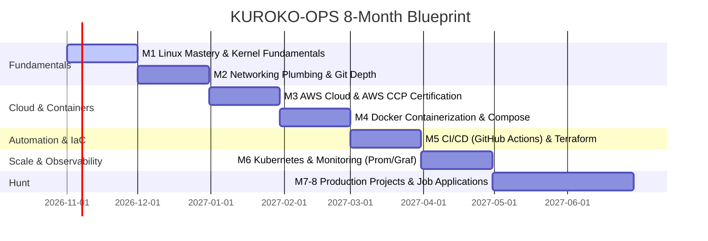

<div align="center">

# 黒子 // KUROKO-OPS
### *The Art of Invisible Infrastructure & Autonomous Systems*

[](#)
[](#)
[](#)
[](#)
[](#)
[](#)

<br/>

> **"In traditional Japanese theatre, the Kuroko (黒子) dress entirely in black against a dark stage.**  
> **They silently move props, operate mechanical stagecraft, and manipulate lighting—completely invisible to the audience.**  
> **To the viewers, they do not exist. But without them, the production collapses.**  
>  
> **This is the essence of DevOps: *We build the invisible foundations so software can fly.*"**

<br/>

[Overview](#-the-philosophy) • [Roadmap](#-the-8-month-master-trajectory) • [Vault Architecture](#-vault-structure--the-alvar-method) • [The 3 Anchor Projects](#-the-3-portfolio-anchor-projects) • [Live Progress](#-live-phase-tracker)

---

</div>

## ⛩️ The Philosophy

**KUROKO-OPS** is a zero-to-production engineering vault built on the **Alvar Method** (*Probe ➔ Plan ➔ Teach ➔ Lock-in*). It tracks an uncompromising 8-month journey from zero operational knowledge to production-grade Cloud, CI/CD, Containerization, and Infrastructure as Code.

Every note here is battle-tested:
- **No Tutorial Hell:** Concepts are immediately codified into terminal drills and live cloud scripts.
- **Strictly High-Signal:** Fluff is stripped away in favor of system call tracing, kernel state inspection (`/proc`), and architectural diagrams.
- **Obsidian Native:** Fully interlinked with native LaTeX math, Mermaid workflows, and deep dive research.

---

## 🗺️ The 8-Month Master Trajectory



---

## 📂 Vault Structure & The Alvar Method

All knowledge in this repository is filed under modular domain directories. Every note follows the **Alvar Architectural Format**:
1. **Unconditional Truths (The Axioms)** — Fundamental kernel and protocol invariants.
2. **Motivated Discovery ("Why does this exist?")** — The real-world production crisis that forced its invention.
3. **Architectural Dependency Maps** — Visual Mermaid workflows.
4. **Hands-On Command Drills** — Executable terminal experiments.
5. **Production Pitfalls & Traps** — Hard lessons from real-world outages.

```text
kuroko-ops/
├── 00-DevOps-Roadmap-Master.md              # Master 8-month curriculum & cert blueprint
├── README.md                                # You are here
└── 01-Linux/                                # Phase 1: Linux & Systems Engineering
    ├── 00-Linux-Tracker.md                  # Central skill checklist & notes index
    ├── 01-NetworkChuck/                     # Video-by-video deep-dive master notes
    │   ├── Ep-01-Terminal-and-Navigation.md # Filesystem tree, paths, and bash prompt
    │   └── Ep-02-Filesystem-Hierarchy.md    # FHS, VFS, File Descriptors (0/1/2), 7 POSIX types
    └── 02-HTB-Academy/                      # HackTheBox Academy Linux Fundamentals
        └── README.md                        # HTB Module 18 labs & challenge write-ups
```

---

## 🏆 The 3 Portfolio Anchor Projects

| # | Project | Architecture & Tech Stack | What It Proves |
|---|---|---|---|
| **01** | **Cloud-Native Web App** | React • AWS S3 • CloudFront CDN • Route 53 • ACM SSL | DNS routing, global asset caching, SSL termination, and cost optimization. |
| **02** | **Production CI/CD Pipeline** | GitHub Actions • Docker • AWS ECR • EC2 • Systemd | End-to-end automated testing, container image build/push, zero-human deploys. |
| **03** | **Automated IaC Infrastructure** | Terraform • AWS VPC • Private Subnets • NAT • SG • EC2 | Declarative infrastructure provisioning with remote state locking in S3/DynamoDB. |

---

## ⚡ Live Phase Tracker: Phase 1 (Linux Fundamentals)

- [x] **Filesystem Hierarchy Standard (FHS)** — The anatomy of `/`, `/etc`, `/var`, `/proc`, and the modern `/usr` merge.
- [x] **"Everything is a File" Doctrine** — Virtual File System (VFS), File Descriptors (`0`, `1`, `2`), and the 7 POSIX file types (`-`, `d`, `l`, `c`, `b`, `s`, `p`).
- [x] **Directory Navigation** — Relative vs. Absolute paths, `pwd`, `ls` flags (`-la`, `-lh`), `cd -` rubber-banding.
- [ ] **File Operations & Text Filtering** — `mkdir -p`, `touch`, `cp -r`, `cat`, `grep -rn`, `head`, `tail -f`.
- [ ] **Permissions & Security** — Octal math (`chmod 755`), ownership (`chown`), `sudoers` privileges.
- [ ] **Process Management & Signals** — `ps aux`, `top`/`htop`, signals (`SIGTERM`, `SIGKILL -9`).
- [ ] **Remote Access & SSH** — Public-key cryptography (`ed25519`), `~/.ssh/authorized_keys`, SSH configs.
- [ ] **Automation Milestone** — Fully automated idempotent Bash deployment script (`setup.sh`).

---

## 💻 The 3-Hour Daily Protocol

```
┌─────────────────────────────────┬─────────────────────────────────┬─────────────────────────────────┐
│         HOUR 1: ABSORB          │          HOUR 2: BUILD          │        HOUR 3: FIX & LOG        │
│  Deep theory & documentation.   │  Hands-on terminal execution.   │ Debug errors, write solutions,  │
│ Synthesize into Alvar notes.    │ Break things on purpose.        │ push clean code to GitHub.      │
└─────────────────────────────────┴─────────────────────────────────┴─────────────────────────────────┘
```

---

## 👤 Author

**Karan Singh**  
*Building scalable systems from first principles.*  
GitHub: [@karnVen](https://github.com/karnVen)

<div align="center">
<sub>Crafted with precision inside the Obsidian Second Brain.</sub>
</div>
